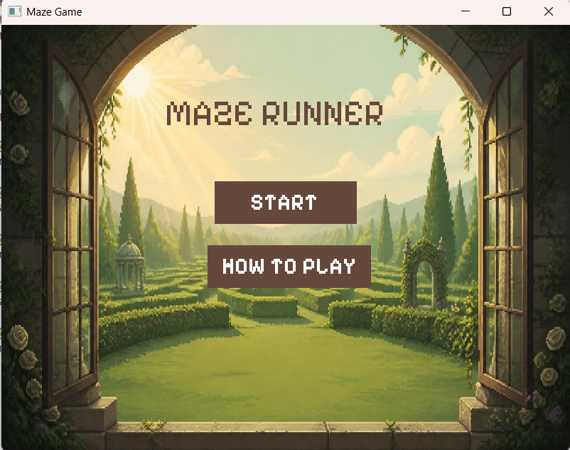
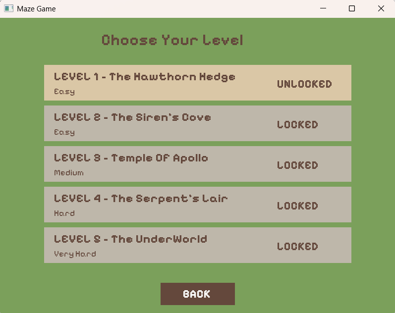
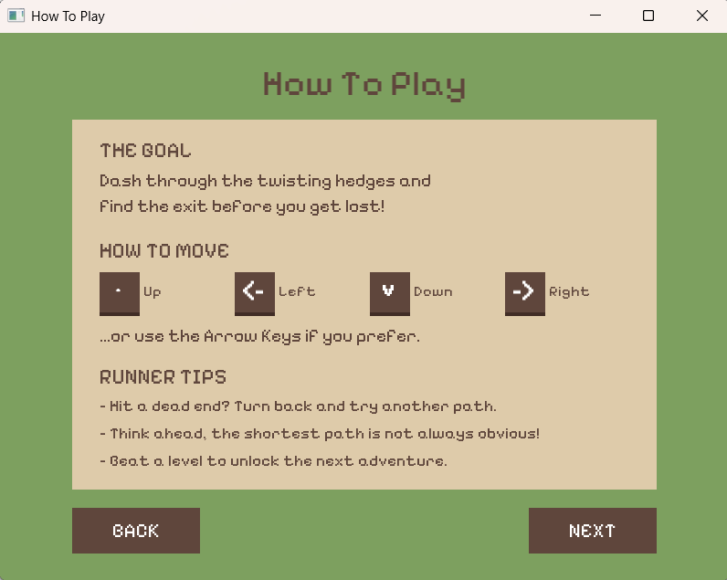
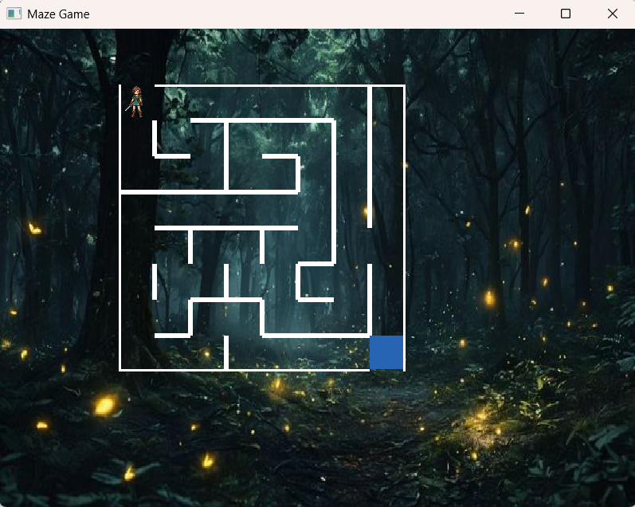
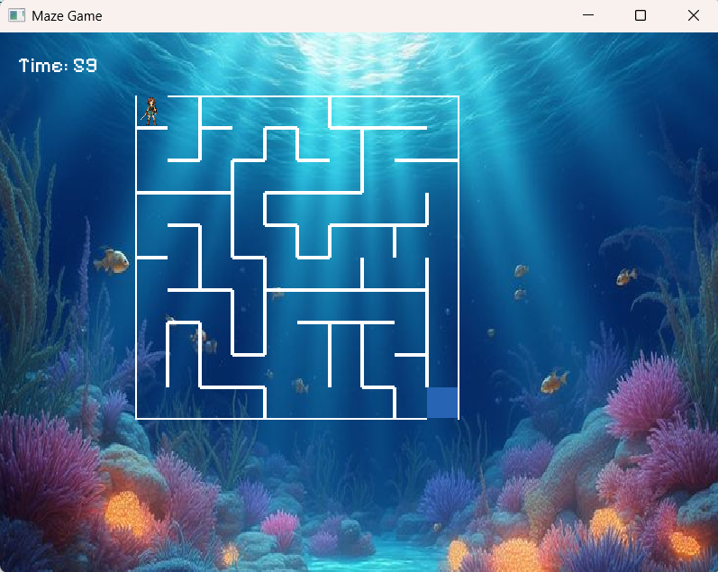
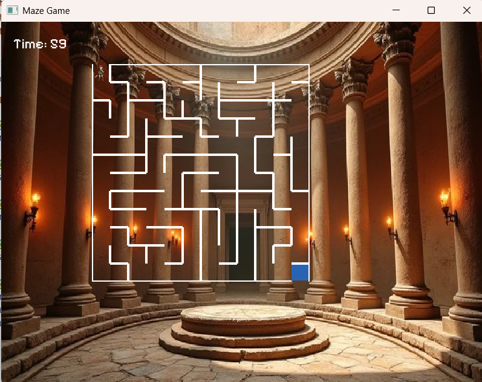
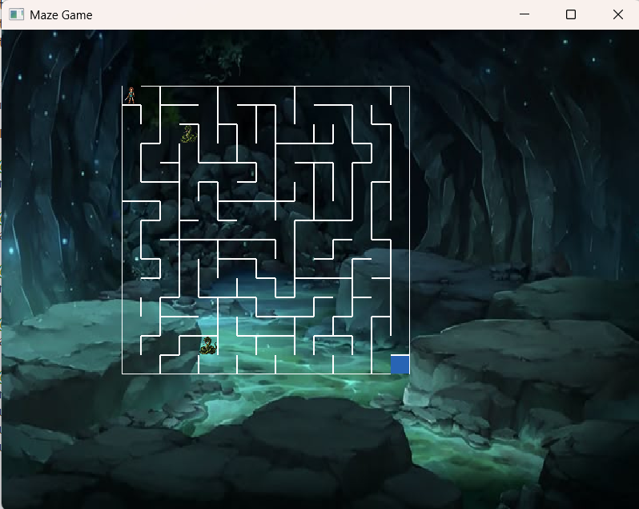
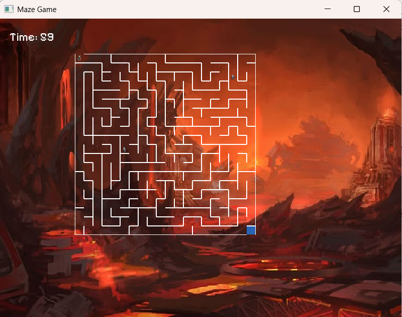
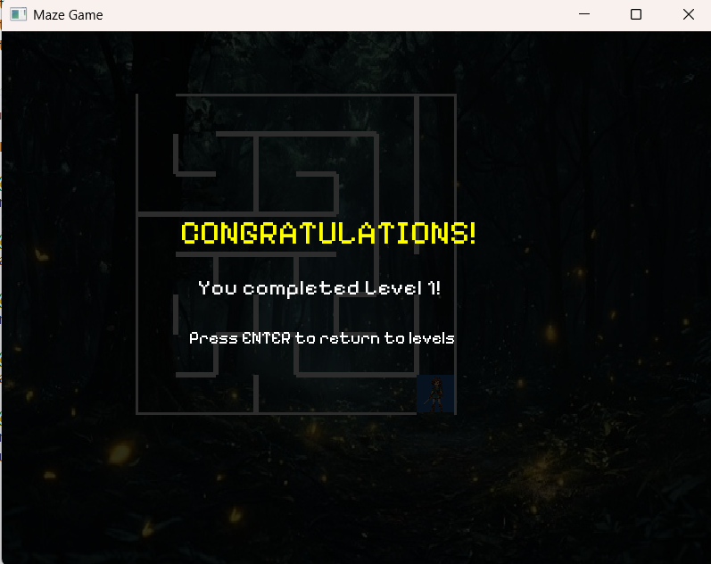
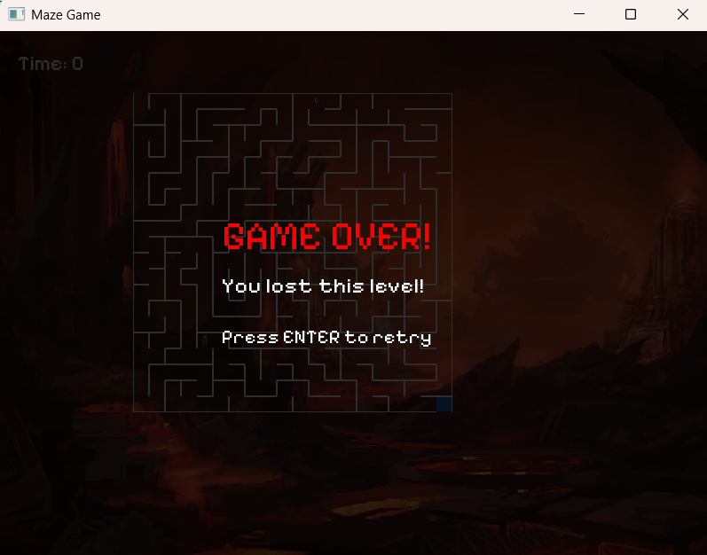

# Maze Runner

## A C++ Maze Adventure Game Built with SFML 3

Navigate through challenging mazes, avoid dangerous monsters, discover safe paths, and race against time to reach the exit! Maze Runner is a multi-level maze game developed in C++ using SFML, combining game development with fundamental Data Structures and Algorithms (DSA).

## Features

- **Five Unique Levels:** Explore five themed levels with different difficulty settings.
- **Random Maze Generation:** Generate maze layouts using a randomized Depth-First Search (DFS) algorithm.
- **Safe Path Detection:** Use Breadth First Search (BFS) to find a path from the starting point to the exit.
- **Monster Encounters:** Avoid monsters and return to the starting position if caught.
- **Timer-Based Gameplay:** Reach the exit before time runs out.
- **Background Music:** Enjoy level-specific background music.
- **Collision Sound Effects:** Hear sound effects when colliding with monsters, with different sounds for selected levels.
- **Level Progression:** Unlock and complete levels as you progress.
- **Graphical User Interface:** Navigate menus, select levels, and view game instructions.
- **Win and Game Over Screens:** Receive feedback when completing a level or running out of time.

## Screenshots

### Welcome Screen



### Level Selection



### Rules / Instructions



### Level 1: The Hawthorn Hedge



### Level 2: The Siren's Cove



### Level 3: Temple Of Apollo



### Level 4: The Serpent's Lair



### Level 5: The UnderWorld



### Level Complete Screen



### Game Over Screen



## Game Levels

| Level | Name | Difficulty |
|:---:|---|---|
| 1 | The Hawthorn Hedge | Easy |
| 2 | The Siren's Cove | Easy |
| 3 | Temple Of Apollo | Medium |
| 4 | The Serpent's Lair | Hard |
| 5 | The UnderWorld | Very Hard |

## Controls

| Key | Action |
|---|---|
| ↑ Up Arrow | Move up |
| ↓ Down Arrow | Move down |
| ← Left Arrow | Move left |
| → Right Arrow | Move right |
| Enter | Continue or select an option, where supported |
| Mouse | Navigate menus and select levels |

## Data Structures and Algorithms

Maze Runner uses fundamental DSA concepts to implement its gameplay.

### 1. Depth-First Search (DFS)

Used for randomized maze generation. A stack tracks the cells being explored, allowing the algorithm to create connected maze paths.

### 2. Breadth-First Search (BFS)

Used to find a safe path from the starting cell to the exit. A queue explores reachable cells level by level.

### 3. Stack

Used during iterative DFS to keep track of the maze-generation process.

### 4. Queue

Used during BFS to process cells in traversal order.

### 5. Two-Dimensional Arrays

Represent the maze grid and store cell information, including wall states, visited status, and coordinates.

### 6. Linked List

Used to manage level information and progression, including unlocked and completed levels.

## Technologies Used

- **Programming Language:** C++
- **Graphics and Window Management:** SFML 3
- **Algorithms:** DFS and BFS
- **Data Structures:** Arrays, Stack, Queue, Linked List
- **Development Environment:** Visual Studio Code
- **Compiler:** GCC (MSYS2 MinGW-w64)

## Installation and Setup

### Prerequisites

- Windows
- Visual Studio Code
- MSYS2 MinGW-w64
- GCC compiler
- SFML 3.x

### Step 1: Clone the Repository

```bash
git clone https://github.com/UniversityCEP/maze-runner
cd maze-runner-game
```

### Step 2: Install SFML

Open the MSYS2 MinGW 64-bit terminal and run:

```bash
pacman -S mingw-w64-x86_64-sfml mingw-w64-x86_64-gcc
```

Make sure your terminal uses the correct MinGW-w64 compiler.

### Step 3: Compile the Project

From the project root directory, run:

```bash
g++ main.cpp Levels.cpp rules.cpp maze.cpp -o main.exe -lsfml-graphics -lsfml-window -lsfml-system -lsfml-audio
```

Make sure the filenames match your actual project files.

### Step 4: Run the Game

```bash
./main.exe
```

## Project Structure

```
Maze-Runner/
├── main.cpp
├── maze.cpp
├── Levels.cpp
├── Levels.hpp
├── rules.cpp
├── rules.hpp
├── screenshots/
│   ├── welcome.png
│   ├── levels.png
│   ├── rules.png
│   ├── l1.png
│   ├── l2.png
│   ├── l3.png
│   ├── l4.png
│   ├── l5.png
│   ├── win.png
│   └── lose.png
├── assets/
│   ├── font.ttf
│   ├── player.png
│   ├── snake.png
│   ├── skeleton.png
│   ├── WelcomeScreenBG.png
│   ├── level1bg.png
│   ├── level2bg.png
│   ├── level3bg.png
│   ├── level4bg.png
│   ├── level5bg.png
│   ├── level1.ogg
│   ├── level2.ogg
│   ├── level3.ogg
│   ├── level4.ogg
│   ├── level5.ogg
│   ├── snake.ogg
│   └── bone.ogg
└── README.md
```

## How to Play

1. Launch Maze Runner.
2. Select Start from the main menu.
3. Choose an unlocked level.
4. Use the arrow keys to navigate the maze.
5. Avoid monsters; getting caught sends the player back to the starting position.
6. Find the exit before the timer reaches zero.
7. Complete levels to progress through the game.

## Learning Objectives

This project provides practical experience with:

- Implementing algorithms in C++.
- Applying DFS and BFS to a real-world grid problem.
- Managing game state and player movement.
- Handling keyboard and mouse input with SFML.
- Working with audio, textures, fonts, and graphical elements.
- Organizing a multi-file C++ project.
- Collaborating on a team-based software project using Git and GitHub.

## Team Project

Maze Runner was developed as a collaborative university project, combining programming, algorithm implementation, graphical design, and game logic.

## Collaborators

| Name | GitHub |
|---|---|
| Alishba | [Alishba964](https://github.com/Alishba964) |
| Zunairah Fatima | [ZunairahFatima](https://github.com/ZunairahFatima) |
| Kanzul Eman | [eman9099](https://github.com/eman9099) |

---

Made with C++ and SFML | Built to explore Data Structures, Algorithms, and Game Development.
